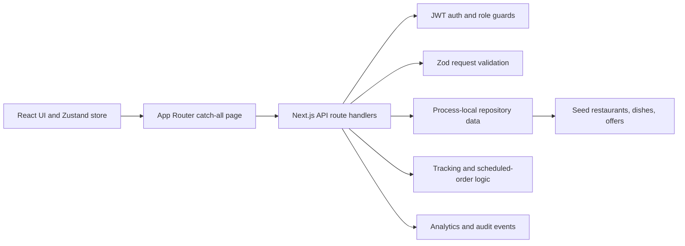

<div align="center">

```text
███████╗ ██████╗  ██████╗ ██████╗ ██╗███████╗██╗  ██╗
██╔════╝██╔═══██╗██╔═══██╗██╔══██╗██║╚══███╔╝╚██╗██╔╝
█████╗  ██║   ██║██║   ██║██║  ██║██║  ███╔╝  ╚███╔╝
██╔══╝  ██║   ██║██║   ██║██║  ██║██║ ███╔╝   ██╔██╗
██║     ╚██████╔╝╚██████╔╝██████╔╝██║███████╗██╔╝ ██╗
╚═╝      ╚═════╝  ╚═════╝ ╚═════╝ ╚═╝╚══════╝╚═╝  ╚═╝
```

# foodiexz

**A full-stack food-ordering experience from discovery to delivery.**

[](https://github.com/vincenzo-afk/foodiexz/actions/workflows/ci.yml) [](https://nextjs.org/) [](https://react.dev/) [](https://www.typescriptlang.org/)

[Live deployment](https://foodiexz.vercel.app) · [Report a bug](https://github.com/vincenzo-afk/foodiexz/issues/new?template=bug_report.md) · [Request a feature](https://github.com/vincenzo-afk/foodiexz/issues/new?template=feature_request.md) · [Source code](https://github.com/vincenzo-afk/foodiexz)

</div>

## <a name="table-of-contents"></a>Table of Contents

- [About the Project](#about-the-project)
- [Tech Stack](#tech-stack)
- [Getting Started](#getting-started)
- [Usage](#usage)
- [API Reference](#api-reference)
- [Project Structure](#project-structure)
- [Features and Roadmap](#features-and-roadmap)
- [Testing](#testing)
- [Deployment](#deployment)
- [Contributing](#contributing)
- [Security](#security)
- [License](#license)
- [Acknowledgments](#acknowledgments)

---

## <a name="about-the-project"></a>About the Project

foodiexz is a food-ordering web application that combines restaurant discovery, menu browsing, cart validation, authenticated checkout, delivery tracking, scheduled orders, wallet payments, reviews, notifications, and operational analytics in one product flow. The visible interface is mounted through `App.tsx` and the catch-all App Router page, while the primary backend surface is implemented with Next.js route handlers under `app/api/`.[^1] [^2]

The project currently uses a process-local data layer seeded from `lib/seedData.ts`. It is straightforward to run locally, but mutable data is not durable across server restarts or instance replacement. The repository also retains a separate Express/SQLite server path under `server/`, which should be treated as an alternate legacy runtime rather than a synchronized second backend.[^3]

### Key capabilities

- **Restaurant discovery:** browse restaurants, cuisines, dishes, search results, recommendations, favorites, and recently viewed items.
- **Reliable checkout:** authenticate the customer, validate the cart with Zod schemas, recalculate prices and delivery charges on the server, reconcile coupons, support wallet payment, and honor idempotency keys.
- **Delivery operations:** expose rider position, route distance, progress, estimated arrival, status history, scheduled-order cutoffs, and in-app notifications.
- **Customer account features:** manage addresses, wallet balance, reviews, preferences, order history, and notification settings.
- **Admin and analytics surfaces:** inspect overview metrics, users, audit events, recommendations, and analytics events.

### Showcase video

The repository includes an editable HTML/GSAP composition and a rendered MP4 overview of the verified product flow. GitHub renders the player where repository-hosted video HTML is supported; the direct MP4 link and editable source remain available as fallbacks.

<video controls width="100%" poster="docs/video/foodiexz-showcase/snapshots/frame-00-at-1.5s.png">
  <source src="docs/video/foodiexz-showcase/renders/foodiexz-showcase.mp4" type="video/mp4">
  Your browser does not support embedded video. [Open the foodiexz showcase MP4](docs/video/foodiexz-showcase/renders/foodiexz-showcase.mp4).
</video>

[Open the editable HTML video source](docs/video/foodiexz-showcase/index.html) · [View the storyboard](docs/video/foodiexz-showcase/STORYBOARD.md) · [View the scene contact sheet](docs/video/foodiexz-showcase/snapshots/contact-sheet.jpg)

### Architecture overview



---

## <a name="tech-stack"></a>Tech Stack

| Area | Technologies used in the repository |
|---|---|
| Frontend | React `19.2.8`, React Router, Zustand, Tailwind CSS `4.1.9`, Radix UI, Lucide React, Recharts, React Leaflet |
| Backend | Next.js `16.3.0` App Router route handlers, TypeScript, JWT authentication, Zod `3.25.76` validation |
| Data and storage | Process-local repository data in `lib/db.ts`, seeded catalog data in `lib/seedData.ts`, client persistence through Zustand middleware |
| Legacy server path | `server/index.js` contains an Express-based server path with SQLite dependencies; the current frontend/API architecture is the Next.js path under `app/` |
| Testing | Vitest `4.1.10`, TypeScript compiler checks, ESLint `9.39.5` |
| Delivery and CI | GitHub Actions workflow in `.github/workflows/ci.yml`; the repository homepage is recorded as Vercel in GitHub metadata |

Exact dependency declarations are maintained in [`package.json`](package.json), with the resolved package graph recorded in [`pnpm-lock.yaml`](pnpm-lock.yaml).[^4]

---

## <a name="getting-started"></a>Getting Started

### Prerequisites

Install Node.js 22 or newer and pnpm 11. The repository’s CI workflow uses those versions, installs with a frozen lockfile, and then runs type checking, linting, tests, and a production build.[^5]

### Installation

```bash
git clone https://github.com/vincenzo-afk/foodiexz.git
cd foodiexz
pnpm install --frozen-lockfile
```

### Environment configuration

Create `.env.local` only when you need to override the documented defaults. The current source reads the following variables.[^6]

| Variable | Used by | Purpose and default |
|---|---|---|
| `NEXT_PUBLIC_API_URL` | `lib/api.ts` | Browser API base URL; defaults to `/api`. |
| `JWT_SECRET` | `lib/auth.ts`, legacy `server/index.js` | JWT signing and verification secret; the Next.js helper has a development fallback, so set a strong secret outside local development. |
| `ADMIN_EMAIL` | `app/api/auth/signup/route.ts` | Signup email that receives the `admin` role. |
| `CRON_SECRET` | `app/api/jobs/scheduled-orders/route.ts` | Secret used to authorize the scheduled-order job endpoint. |
| `PORT` | legacy `server/index.js` | Express server port; defaults to `5000` when the legacy server is used. |
| `CLIENT_URL` | legacy `server/index.js` | Express CORS origin; defaults to `http://localhost:5173`. |

Example configuration:

```env
NEXT_PUBLIC_API_URL=/api
JWT_SECRET=replace-with-a-long-random-development-secret
ADMIN_EMAIL=admin@example.com
CRON_SECRET=replace-with-a-cron-secret
```

Do not commit `.env`, `.env.local`, secrets, database files, or generated build output. The root [`.gitignore`](.gitignore) contains the current ignore rules.

### Run the development server

```bash
pnpm dev
```

The Next.js development server prints the local URL and port when it starts. Use `pnpm start` after creating a production build to run the compiled application.

### Build and start production output

```bash
pnpm build
pnpm start
```

The repository does not include a Dockerfile or compose file. Containerization is therefore an integration task rather than an existing repository command.

---

## <a name="usage"></a>Usage

Open the application in a browser, choose a restaurant, browse dishes, add items to the cart, and proceed through the authenticated checkout flow. The client API wrapper in [`lib/api.ts`](lib/api.ts) groups browser calls for restaurants, dishes, orders, tracking, offers, wallet actions, addresses, notifications, scheduled orders, analytics, recommendations, admin operations, and favorites.[^7]

Authenticated calls use a bearer token stored by the client session. A typical request against the local API looks like this:

```bash
curl http://localhost:3000/api/restaurants
```

A protected request supplies the bearer token returned by the login flow:

```bash
curl http://localhost:3000/api/orders \
  -H "Authorization: Bearer $FOODIEXZ_TOKEN"
```

The order handler recalculates the submitted cart against server-side dish and restaurant data before creating an order. It accepts an `Idempotency-Key` header for safe retries and returns a conflict when submitted totals no longer match the server calculation.[^8]

---

## <a name="api-reference"></a>API Reference

All endpoints are implemented as Next.js route handlers below `app/api/`. Protected endpoints use the bearer-token session established by the authentication routes. Request schemas and normalized validation errors are defined in [`lib/validation.ts`](lib/validation.ts).[^9]

<details>
<summary>Authentication, catalog, discovery, and checkout</summary>

| Method | Path | Purpose |
|---|---|---|
| `POST` | `/api/auth/signup` | Create a user account. |
| `POST` | `/api/auth/login` | Authenticate a user and issue a session token. |
| `GET` | `/api/user` | Return the authenticated user profile. |
| `GET` | `/api/restaurants` | List restaurants. |
| `GET` | `/api/restaurants/<id>` | Return a restaurant and its dishes. |
| `GET` | `/api/restaurants/search` | Search restaurants. |
| `GET` | `/api/dishes/<id>` | Return a dish. |
| `GET` | `/api/dishes/search` | Search dishes. |
| `GET` | `/api/recommendations` | Return ranked restaurant recommendations. |
| `GET` | `/api/offers` | List active offers. |
| `POST` | `/api/offers/validate` | Validate a coupon or offer payload. |
| `POST` | `/api/cart/validate` | Validate cart contents before checkout. |
| `POST` | `/api/orders` | Create an order after authentication and server-side total validation. |
| `GET` | `/api/orders` | List the authenticated user’s orders. |
| `GET` | `/api/orders/<id>` | Return an order detail. |
| `GET` | `/api/orders/<id>/tracking` | Return tracking, route, ETA, progress, and status history. |
| `POST` | `/api/orders/<id>/review` | Create or update an order review. |
| `POST` | `/api/orders/<id>/status` | Transition order status. |

</details>

<details>
<summary>Customer account, wallet, notifications, and scheduling</summary>

| Method | Path | Purpose |
|---|---|---|
| `GET` / `POST` | `/api/addresses` | List or create delivery addresses. |
| `PUT` / `DELETE` | `/api/addresses/<id>` | Update or delete an address. |
| `POST` | `/api/addresses/<id>/default` | Set an address as the default. |
| `GET` / `POST` | `/api/favorites` | List or save favorite restaurants. |
| `DELETE` | `/api/favorites/<restaurantId>` | Remove a favorite restaurant. |
| `GET` / `POST` | `/api/notifications` | List or create in-app notifications. |
| `PATCH` | `/api/notifications/<id>` | Update notification state. |
| `GET` / `PUT` | `/api/notifications/preferences` | Read or update notification preferences. |
| `GET` / `POST` | `/api/wallet` | Read wallet data or create a top-up. |
| `GET` / `POST` | `/api/scheduled-orders` | List or create scheduled orders. |
| `PATCH` / `DELETE` | `/api/scheduled-orders/<id>` | Update or cancel a scheduled order. |
| `GET` | `/api/health` | Return an application health response. |
| `POST` | `/api/contact` | Validate and submit a contact request. |

</details>

<details>
<summary>Analytics, administration, and jobs</summary>

| Method | Path | Purpose |
|---|---|---|
| `POST` | `/api/analytics` | Record analytics events. |
| `GET` | `/api/admin/overview` | Return administrative overview data. |
| `GET` | `/api/admin/users` | List administrative user data. |
| `PATCH` | `/api/admin/users/<id>/role` | Change a user role. |
| `GET` | `/api/admin/audit` | Return audit records. |
| `POST` | `/api/jobs/scheduled-orders` | Process scheduled-order work using `CRON_SECRET`. |

</details>

The repository does not include an OpenAPI document. For exact payload fields, read the route handler and its schema together; the most security-sensitive checkout behavior is implemented in [`app/api/orders/route.ts`](app/api/orders/route.ts).[^8]

---

## <a name="project-structure"></a>Project Structure

```text
foodiexz/
├── app/
│   ├── [[...slug]]/page.tsx       # Catch-all page that mounts App.tsx
│   └── api/                       # Next.js route handlers
├── components/                    # Reusable UI and Radix-based components
├── lib/
│   ├── api.ts                     # Browser API wrapper
│   ├── auth.ts                    # JWT and role guards
│   ├── db.ts                      # Process-local repository and tracking logic
│   ├── seedData.ts                # Restaurants, dishes, and offers
│   └── validation.ts              # Zod request schemas
├── public/                        # Icons, logos, and static assets
├── server/                        # Legacy Express/SQLite server path
├── store/useStore.ts              # Persisted Zustand client store
├── styles/globals.css             # Tailwind and application design tokens
├── App.tsx                        # Main client application shell
├── package.json                   # Scripts and dependencies
├── pnpm-lock.yaml                 # Resolved dependency graph
└── .github/workflows/ci.yml       # CI: typecheck, lint, test, build
```

The abbreviated tree focuses on the application entry point, domain logic, API surface, and operational configuration. Reusable UI primitives under `components/ui/` are implementation details of the interface layer.

---

## <a name="features-and-roadmap"></a>Features and Roadmap

### Implemented

| Status | Area | Evidence |
|---|---|---|
| ✅ | Restaurant and dish discovery | Restaurant, dish, search, offer, and recommendation routes plus the client API wrapper |
| ✅ | Authenticated checkout | Order creation route, JWT guards, Zod validation, server-side total reconciliation, wallet handling, idempotency |
| ✅ | Order history and reviews | Order detail, order list, review, and status routes |
| ✅ | Live delivery tracking | Tracking route and geospatial helpers in `lib/db.ts` |
| ✅ | Scheduled orders | Scheduling route, lead-time validation, cutoff timestamps, and job route |
| ✅ | Customer operations | Addresses, favorites, notifications, preferences, wallet, analytics, and audit data |
| ✅ | Automated quality checks | GitHub Actions workflow with typecheck, lint, Vitest, and production build |

### Known limitations and next priorities

The current repository uses process-local server data and has no committed license or deployment manifest. It also retains a legacy Express/SQLite path beside the primary Next.js architecture. A production roadmap should therefore prioritize durable database storage, explicit deployment configuration, a published license, and a stable API contract before adding more surface area.

For change history, use the repository’s [commit log](https://github.com/vincenzo-afk/foodiexz/commits/main) and [releases page](https://github.com/vincenzo-afk/foodiexz/releases).

---

## <a name="testing"></a>Testing

Run the checks locally with the same commands used by the CI workflow:

```bash
pnpm typecheck
pnpm lint
pnpm test
pnpm build
```

The test suite uses Vitest and includes database and validation tests. CI runs on pushes and pull requests targeting `main`, installs with `pnpm install --frozen-lockfile`, and executes type checking, linting, unit tests, and a production build in one quality job.[^5]

The editable showcase composition is independently validated with HyperFrames and rendered to an 18-second MP4. Its project files live under [`docs/video/foodiexz-showcase/`](docs/video/foodiexz-showcase/).

---

## <a name="deployment"></a>Deployment

GitHub metadata records the live homepage as [foodiexz.vercel.app](https://foodiexz.vercel.app). The repository contains no Vercel project file, Dockerfile, or compose manifest, so deployment settings should be configured in the hosting platform rather than inferred from source files.

For a Next.js deployment, install dependencies with the frozen lockfile, run `pnpm build`, and start the result with `pnpm start`. Configure `JWT_SECRET`, `ADMIN_EMAIL`, and `CRON_SECRET` in the deployment environment, and set `NEXT_PUBLIC_API_URL` only when the API is served from a different base path. Because the current data layer is process-local, a multi-instance deployment should not be treated as durable persistence without a database migration.

---

## <a name="contributing"></a>Contributing

Create a focused branch from `main`, keep changes scoped to one concern, and run type checking, linting, tests, and the production build before opening a pull request. Pull requests should describe the behavior changed, include the verification commands that passed, and call out any API, security, data-model, or deployment impact.

Use clear, imperative commit messages such as `feat: add scheduled order reminders` or `fix: reject stale checkout totals`. Do not commit secrets, generated build output, local databases, or unrelated editor files. The detailed contribution workflow is documented in [`CONTRIBUTING.md`](CONTRIBUTING.md), and pull requests use [`.github/PULL_REQUEST_TEMPLATE.md`](.github/PULL_REQUEST_TEMPLATE.md).

---

## <a name="security"></a>Security

The application uses JWT authentication and role guards, Zod input validation, server-side order total recalculation, coupon reconciliation, idempotency-key handling, and a secret-protected scheduled-order job route.[^6] [^8] These controls are application behaviors, not a substitute for production secret management or durable infrastructure.

Do not use the development JWT fallback in production. Report a suspected vulnerability privately through the repository owner’s [GitHub security page](https://github.com/vincenzo-afk/foodiexz/security), if enabled, or contact the maintainer through the repository profile. Do not disclose exploitable details in a public issue.

The repository’s vulnerability-reporting process is documented in [`SECURITY.md`](SECURITY.md). No response-time or supported-version promise is made here, and no Dependabot configuration is currently tracked.

---

## <a name="license"></a>License

No `LICENSE` file is currently present in the repository. Until the owner adds a license, the code should be treated as **all rights reserved** and should not be redistributed under an assumed open-source license.

---

## <a name="acknowledgments"></a>Acknowledgments

The project uses open-source libraries including Next.js, React, TypeScript, Tailwind CSS, Radix UI, Zustand, Zod, Vitest, Leaflet, Recharts, and Lucide React. The repository also records UI and image attributions in [`Attributions.md`](Attributions.md).

The current GitHub contributor is **vincenzo-afk**, the owner of [github.com/vincenzo-afk/foodiexz](https://github.com/vincenzo-afk/foodiexz).

---

## <a name="references"></a>References

[^1]: [Application entry point](https://github.com/vincenzo-afk/foodiexz/blob/main/App.tsx) and [catch-all App Router page](https://github.com/vincenzo-afk/foodiexz/blob/main/app/%5B%5B...slug%5D%5D/page.tsx)
[^2]: [Next.js API route handlers](https://github.com/vincenzo-afk/foodiexz/tree/main/app/api)
[^3]: [Repository data layer](https://github.com/vincenzo-afk/foodiexz/blob/main/lib/db.ts) and [seed data](https://github.com/vincenzo-afk/foodiexz/blob/main/lib/seedData.ts)
[^4]: [Package manifest](https://github.com/vincenzo-afk/foodiexz/blob/main/package.json) and [resolved dependency lockfile](https://github.com/vincenzo-afk/foodiexz/blob/main/pnpm-lock.yaml)
[^5]: [Continuous integration workflow](https://github.com/vincenzo-afk/foodiexz/blob/main/.github/workflows/ci.yml)
[^6]: [Authentication helpers](https://github.com/vincenzo-afk/foodiexz/blob/main/lib/auth.ts) and [validation schemas](https://github.com/vincenzo-afk/foodiexz/blob/main/lib/validation.ts)
[^7]: [Client API wrapper](https://github.com/vincenzo-afk/foodiexz/blob/main/lib/api.ts)
[^8]: [Order route handler](https://github.com/vincenzo-afk/foodiexz/blob/main/app/api/orders/route.ts)
[^9]: [API route inventory](https://github.com/vincenzo-afk/foodiexz/tree/main/app/api)

---

<p align="center"><a href="#foodiexz">Back to top</a></p>

<p align="center">Built with care by <a href="https://github.com/vincenzo-afk">vincenzo-afk</a>.</p>
